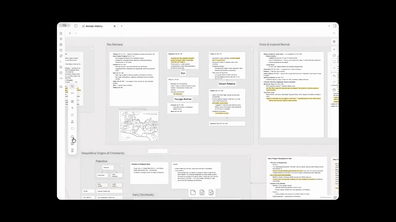

# Canvas Joy

**English** · [简体中文](README.zh-CN.md)

Heptabase-style visual thinking for native Obsidian Canvas, stored cleanly in standard `.canvas` files.

## Features

- **Chronos Timeline**: Slice cards by historical period with auto-parsed dates
- **Section Outline**: Floating top-level section drawer (`⌘⇧O`) with click-to-jump, drag-to-reorder, and compact capsule mode
- **HD PNG Export**: Right-click blank canvas, a card, a section, or a multi-selection to export clean 2x PNGs with theme background and auto-bounds padding
- **Smart PDF Paste**: Automatically cleans hard line breaks and extra spaces when pasting text copied from PDFs
- **Free Edge Anchors**: Connect arrows to any point along a card's edges
- **Toolbar & Tinted Cards**: Quick Heptabase-style toolbar, 9 card colors, and floating format bar
- **In-Card To-dos**: Click checkboxes directly in preview mode
- **Collapse & Focus**: Fold cards or sections, and dim everything outside your focus
- **Search, Align & Minimap**: In-canvas search (`⌘F`), multi-select alignment, and whiteboard minimap
- **Mindmaps & Zoom Readability**: Clean SVG mindmaps (`Tab` to branch) and readable titles when zoomed out

## Demo

[Watch HD video (MP4)](assets/demo.mp4)

## Installation

### Community Plugins
1. Open **Settings → Community plugins → Browse**.
2. Search for **Canvas Joy**, install, and enable.

### Manual Installation
1. Download `main.js`, `manifest.json`, and `styles.css` from [Releases](https://github.com/joyitang/canvas-joy/releases).
2. Place them in `<your-vault>/.obsidian/plugins/canvas-joy/`.
3. Reload Obsidian and enable **Canvas Joy**.

## License

[MIT](LICENSE)
