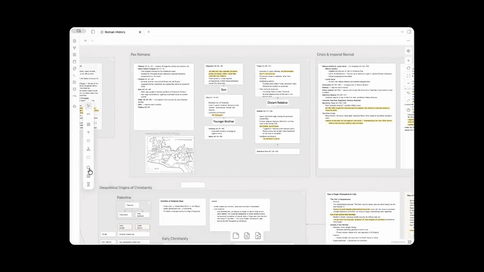

# Canvas Joy

[English](README.md) · **简体中文**

在 Obsidian 原生 Canvas 上提供 Heptabase 风格的视觉思考体验，所有数据保存在标准 `.canvas` 文件中。

## 核心功能

- **Chronos 时间轴**：自动识别卡片年份，按历史时期切片对照
- **自由连线锚点**：箭头可停在卡片四条边的任意位置，支持智能平齐与手柄微调
- **工具栏与底色卡片**：Heptabase 风格左侧工具栏、9 种柔和卡片底色与划词格式条
- **卡片内待办**：预览态直接勾选复选框，行首 `[] ` 快速新建任务
- **折叠与聚焦**：卡片与分区一键折叠，聚焦模式（`F`）高亮当前内容
- **搜索、对齐与小地图**：画布内搜索（`⌘F`）、多选对齐分布与可收起白板小地图
- **思维导图与远景可读**：世界层 SVG 导图（`Tab` 建子节点）及缩小时清晰显示大字标题

## 演示

[查看高清视频（MP4）](assets/demo.mp4)

## 安装

### 社区插件
1. 打开 **设置 → 第三方插件 → 浏览**。
2. 搜索 **Canvas Joy**，安装并启用。

### 手动安装
1. 从 [Releases](https://github.com/joyitang/canvas-joy/releases) 下载 `main.js`、`manifest.json` 和 `styles.css`。
2. 放入 `<你的仓库>/.obsidian/plugins/canvas-joy/` 目录。
3. 重启 Obsidian 并启用 **Canvas Joy**。

## License

[MIT](LICENSE)
